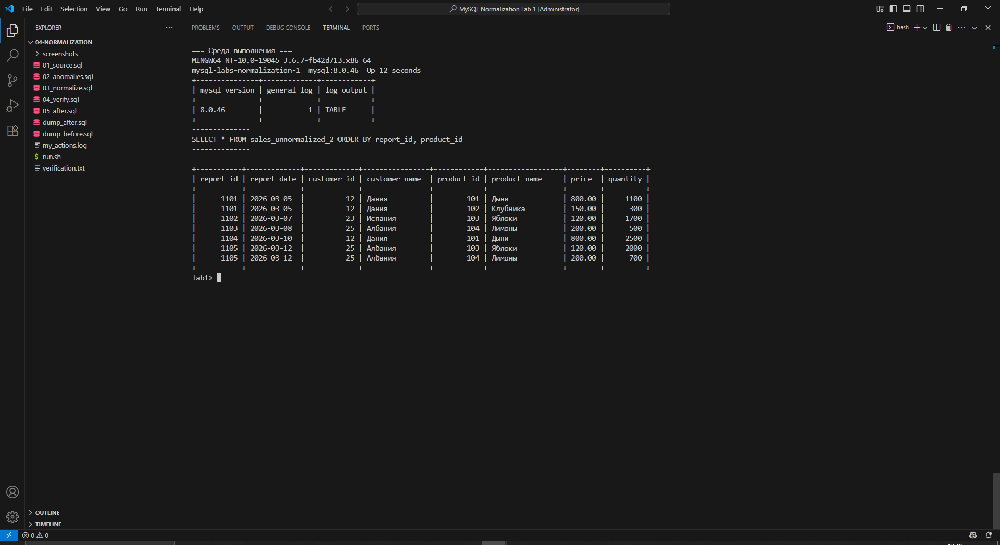
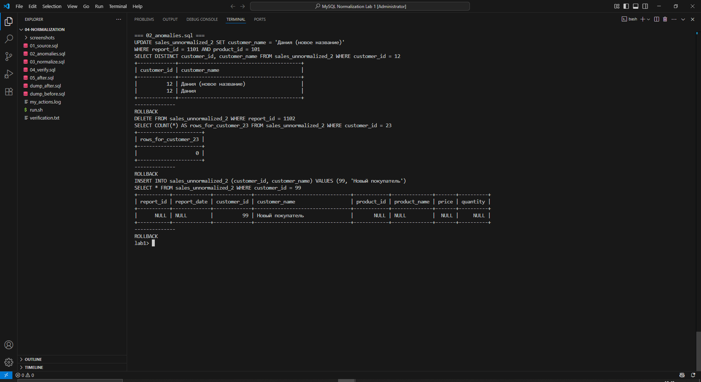
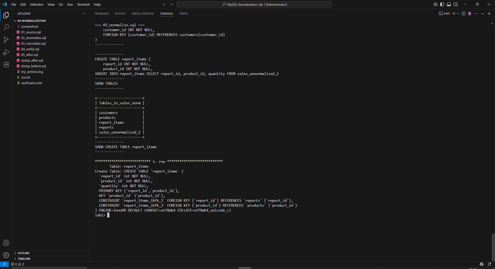
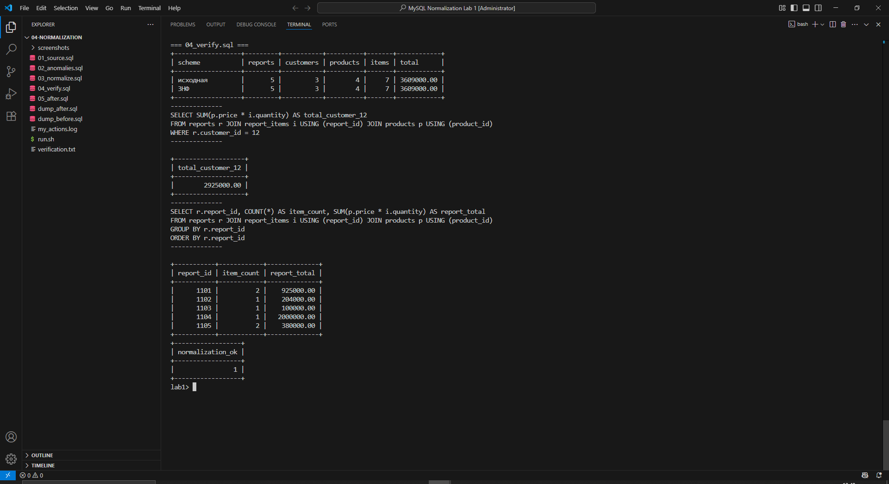
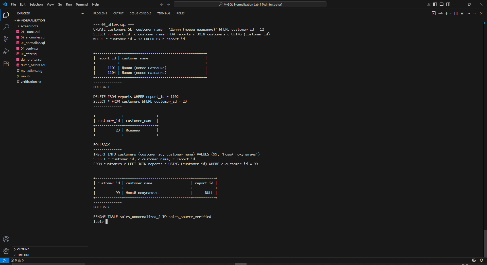
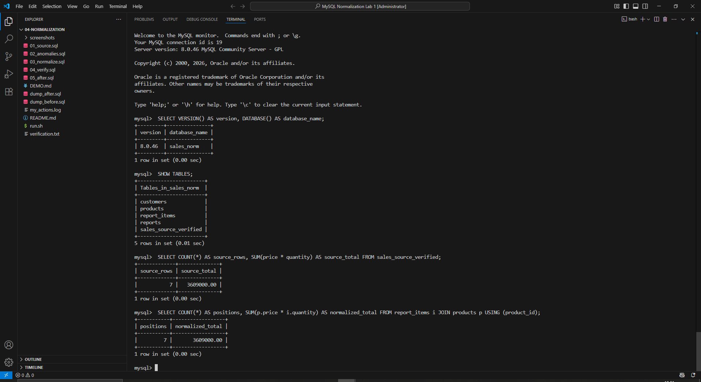

# Лабораторная работа № 1. Нормализация данных в MySQL

**Цель работы** — привести таблицу продаж к третьей нормальной форме и проверить, что все данные сохранены.

## 1. Исходная таблица

В MySQL 8.0.46 создал базу `sales_norm` и таблицу `sales_unnormalized_2`. В неё добавил семь записей из методички. Работу выполнил в VS Code через Git Bash и Docker CLI. [Методичка](https://github.com/rurewa/imfua/blob/main/content/Courses/Basics_database_design/content/bd/Normalization_1.md)

Для первого запуска откройте папку лабораторной в терминале Git Bash и выполните `bash run.sh run`. Создание и заполнение исходной таблицы описано в [01_source.sql](01_source.sql).

## 2. Аномалии исходной таблицы

- При **обновлении** одной строки у покупателя `12` появились два разных названия.
- При **вставке** покупателя `99` без отчёта появилась неполная строка с `NULL` в полях отчёта и товара.
- При **удалении** единственного отчёта покупателя `23` сведения о нём исчезли из таблицы.

Каждый опыт выполнен в отдельной транзакции с `ROLLBACK`. Исходные семь записей сохранились. [02_anomalies.sql](02_anomalies.sql)

## 3. Нормализация и перенос данных

В исходной таблице дата и покупатель зависели от номера отчёта, а название и цена товара — от кода товара. Имя покупателя зависело от его кода. Для перехода к 3НФ разделил эти данные на четыре таблицы:

- `customers` — покупатели, первичный ключ `customer_id`.
- `products` — товары и цены, первичный ключ `product_id`.
- `reports` — даты отчётов и покупатели, первичный ключ `report_id`, внешний ключ `customer_id`.
- `report_items` — товары и их количество по отчётам. Первичный ключ `(report_id, product_id)`. Оба поля также являются внешними ключами.

Перенёс данные через `INSERT ... SELECT`. Для покупателей, товаров и отчётов использовал `DISTINCT`, чтобы убрать повторы. [03_normalize.sql](03_normalize.sql)

## 4. Проверка результата

До и после переноса совпали **5 отчётов, 3 покупателя, 4 товара и 7 позиций**. Общая сумма `SUM(price * quantity)` в обеих схемах составила **3 609 000,00**. Для покупателя `12` запрос вернул **2 925 000,00**. Сравнение всех полей через `JOIN` показало, что расхождений нет. [04_verify.sql](04_verify.sql)

На схеме 3НФ повторил три опыта. Одно изменение имени видно во всех отчётах покупателя. Покупатель остаётся в справочнике после удаления отчёта, а нового покупателя можно добавить отдельно. После опытов выполнил откат и сохранил исходную таблицу под именем `sales_source_verified`. [05_after.sql](05_after.sql)

## 5. Дампы и журнал

Сохранил [дамп исходной таблицы](dump_before.sql), [дамп четырёх таблиц в 3НФ](dump_after.sql) и [журнал своих SQL-команд](my_actions.log). Оба дампа восстановил в отдельном временном контейнере. Данные совпали с проверенной базой.

## Вывод

Привёл данные к 3НФ. Схема из четырёх таблиц устранила показанные аномалии, сохранила все семь позиций и общую сумму.
